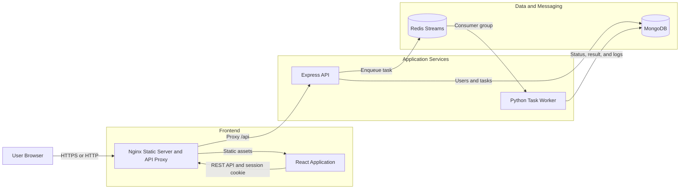
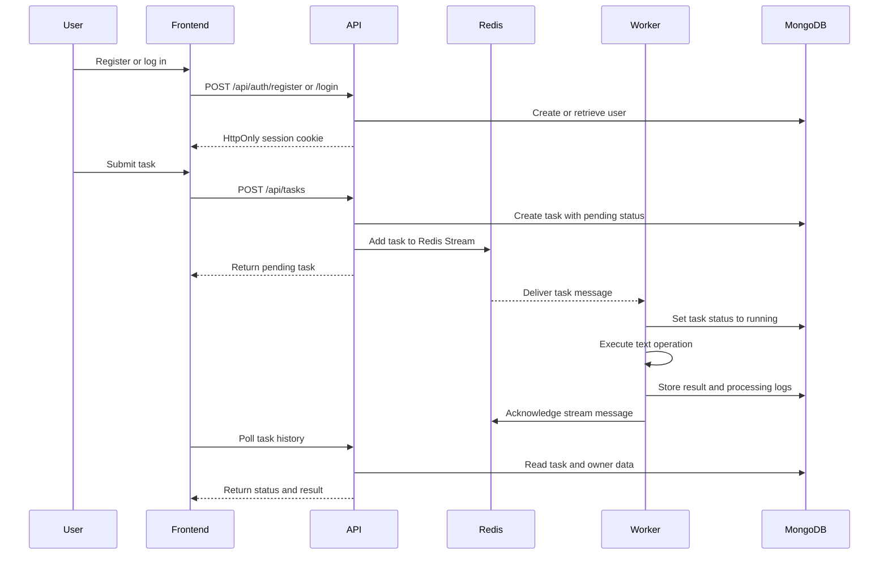
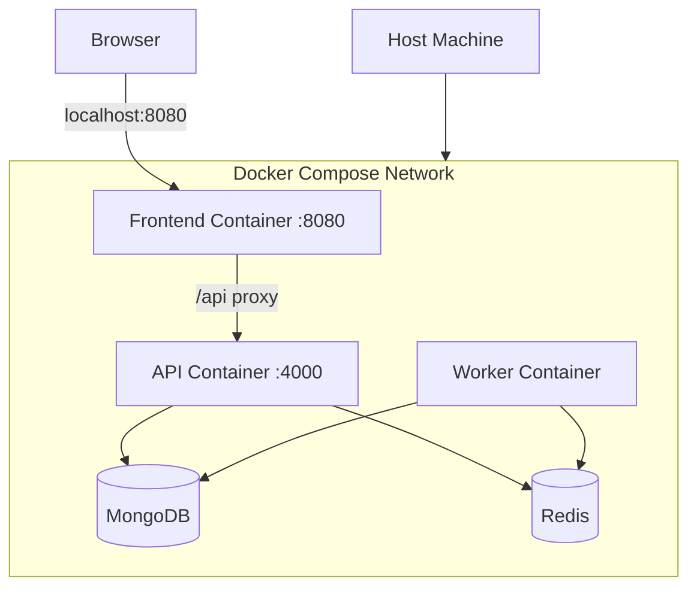
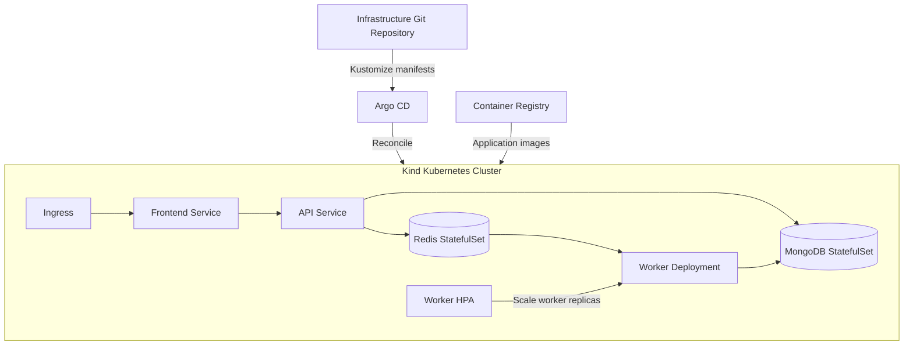
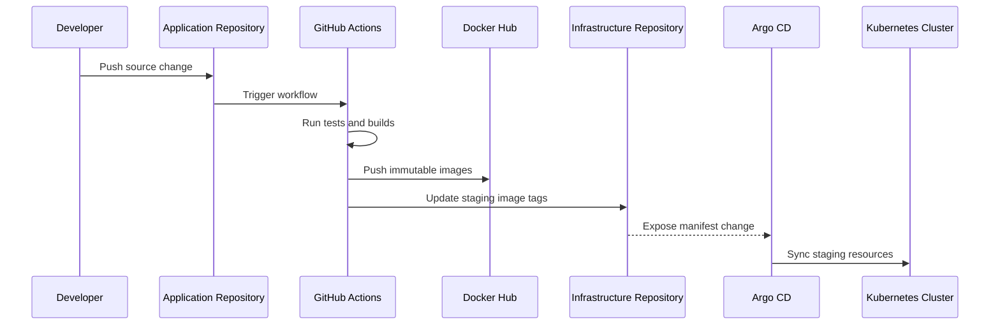

# AI Task Platform Architecture

## 1. Overview

The AI Task Platform is a containerized text-processing application. Users authenticate through a React interface, submit text tasks to an Express API, and receive processed results asynchronously from a Python worker.

MongoDB stores user accounts and task records. Redis Streams acts as the work queue, and the worker updates task status and results in MongoDB.

## 2. System Architecture



## 3. Components

### 3.1 Frontend

The frontend is a React application built with Vite. Nginx serves the compiled static assets and proxies `/api` requests to the backend API.

Primary responsibilities:

- User registration and login
- Authenticated session handling
- Task submission
- Task status and result display
- Automatic task refresh after submission

### 3.2 Backend API

The backend is a Node.js application using Express and Mongoose.

Primary responsibilities:

- Authentication and password hashing
- HttpOnly session cookie management
- Task validation
- Persistence of task records in MongoDB
- Publication of task messages to Redis Streams
- Authorization of task ownership

Supported operations:

- Uppercase
- Lowercase
- Reverse
- Word count

### 3.3 Worker

The worker is a Python service that consumes messages through a Redis consumer group.

Processing flow:

1. Read a message from the task stream.
2. Validate the task identifier and queued task data.
3. Change the task status from `pending` to `running`.
4. Execute the requested operation.
5. Store `success` or `failed` status, result, and processing logs in MongoDB.
6. Acknowledge the Redis stream message only after the database update.

Pending messages can be reclaimed after an idle period and prevent duplicate processing of terminal tasks.

### 3.4 MongoDB

MongoDB is the persistent data store.

Collections:

- `users`: authentication identities and password hashes
- `tasks`: task input, operation, status, result, owner, timestamps, and processing logs

Docker Compose and Kubernetes use persistent volumes or persistent volume claims to retain database data.

### 3.5 Redis

Redis provides queue semantics through Redis Streams.

The task stream contains:

- `taskId`
- `operation`
- `input`

Worker instances use a shared Redis consumer group to distribute tasks. If Redis is unavailable, the API records the task as failed and returns HTTP 503.

## 4. Request Flow



## 5. Docker Compose Deployment

Docker Compose runs the complete application locally:

- `mongodb`: MongoDB 7.0
- `redis`: Redis 7
- `api`: Node.js Express API
- `worker`: Python worker
- `frontend`: Nginx and compiled React application

MongoDB and Redis use named volumes for persistence. The frontend listens on port `8080` and proxies API requests to the backend on the internal Compose network.



## 6. Kubernetes Deployment

Kubernetes manifests are maintained in a separate infrastructure repository. The deployment is organized with Kustomize into base manifests and staging and production overlays.

### Base resources

- API Deployment and Service
- Frontend Deployment and Service
- Worker Deployment and Horizontal Pod Autoscaler
- MongoDB and Redis StatefulSets
- Persistent volume claims
- ConfigMap
- Ingress

### Staging and production overlays

The overlays define:

- Environment-specific namespaces
- Replica counts
- Ingress hosts
- Image tags
- Frontend origin configuration

A Kind cluster may be used for local Kubernetes testing.



## 7. GitOps and CI/CD

The project uses two repositories:

- Application repository: application source, tests, Dockerfiles, and GitHub Actions workflows
- Infrastructure repository: Kubernetes manifests and Argo CD application definitions

### Continuous integration

On pushes and pull requests, GitHub Actions runs:

- Backend integration tests
- Frontend lint and build
- Worker unit and integration tests
- Docker image builds

### Image publication

For changes pushed to `main`, the publish workflow:

1. Builds API, worker, and frontend images.
2. Publishes immutable `sha-<commit>` tags to Docker Hub.
3. Updates the staging Kustomize image tags in the infrastructure repository.
4. Allows Argo CD to reconcile the staging application.

Production promotion is a separate manual workflow that requires the immutable staging image tag and may use a protected production environment.



## 8. Security

- Passwords are stored as bcrypt hashes.
- Authentication tokens are sent in HttpOnly, SameSite cookies.
- API and worker containers run as non-root users.
- JWT secrets are supplied through environment variables or Kubernetes Secrets.
- Database and queue services are not publicly exposed in Docker Compose or the base Kubernetes Services.
- Secrets are excluded from source control.
- Docker Hub publishing uses an access token instead of an account password.

## 9. Scaling

### API

The API is stateless and can be scaled horizontally because session verification does not require in-memory server state.

### Worker

Multiple workers consume from one Redis consumer group. Kubernetes can scale workers from one to three replicas based on CPU usage through an HPA. Metrics Server supplies CPU metrics to Kubernetes.

### Database and Redis

The current MongoDB and Redis deployments are single replicas with persistent storage. For production workloads, managed services or replicated database architectures should be considered along with backup and recovery procedures.

## 10. Configuration

Key environment variables:

- `JWT_SECRET`: authentication signing secret
- `MONGODB_URI`: MongoDB connection string
- `REDIS_URL`: Redis connection string
- `TASK_STREAM_KEY`: Redis task stream name
- `TASK_CONSUMER_GROUP`: Redis worker consumer group
- `FRONTEND_ORIGIN`: permitted frontend origin

Local development values are stored in the root or backend environment files. Kubernetes values are supplied through ConfigMaps and Secrets.

## 11. Failure Handling

- MongoDB connection failures prevent API startup until the database is available.
- Redis publication failures mark tasks as failed and return HTTP 503.
- Worker database failures are logged and retried.
- Reclaimed Redis messages are reprocessed after the configured idle period.
- Kubernetes readiness and liveness probes monitor application health.
- Argo CD detects configuration drift and, where configured, can self-heal Kubernetes resources.

## 12. Repository Structure

```text
venture_assignment/
├── frontend/                 React and Vite application
├── backend/                  Express API and Mongoose models
├── worker/                   Redis Stream task worker
├── compose.yaml              Local Docker Compose stack
├── .github/workflows/        CI, publishing, and promotion workflows
└── architecture.md           System architecture documentation

ai-task-platform-infra/
├── k8s/base/                 Shared Kubernetes resources
├── k8s/overlays/staging/     Staging configuration
├── k8s/overlays/production/  Production configuration
└── argocd/                   Argo CD Application definitions
```
